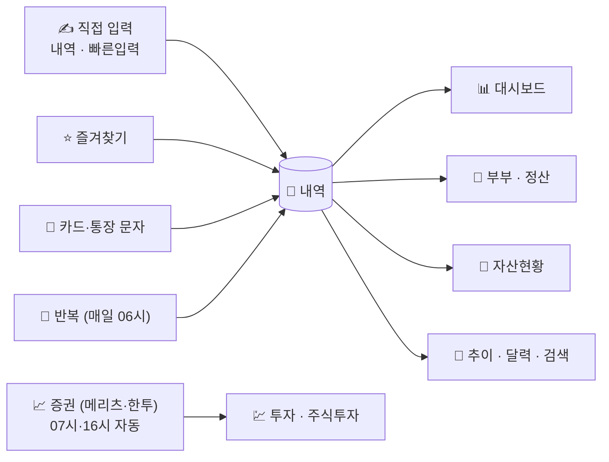

# 🏠 우리집 가계부

> 구글 시트 + Apps Script로 만든 **부부 가계부**. 폰에서 적고, 매일 아침 자동으로 정리되고, 대시보드에서 한눈에 봅니다.

| 📗 바로 써 보기 | 📖 어떻게 쓰나요 | 🛠️ 설치·개발 |
|---|---|---|
| **[빈 템플릿 복사하기](https://docs.google.com/spreadsheets/d/15V-34OK4DJQ34-HHy2wkS0SR39zv_nRwyJ14e3LmvO8/copy)** | **[사용법 (자세히)](docs/USAGE.md)** | [설치·개발 가이드](docs/SETUP.md) |

> 템플릿은 값이 없는 빈 시트입니다. 링크를 열면 **내 드라이브로 사본**이 만들어지고, 스크립트도 함께 복사됩니다.
> 사용자는 **신랑 · 신부**로 표시됩니다. `설정` 탭의 사용자 칸에서 **한 칸씩** 이름을 고치면 내역·반복·즐겨찾기까지 자동으로 바뀝니다 (탭 이름 `주식_신랑` 등은 그대로 둡니다).

---

## ⚡ 30초 요약

| 하고 싶은 일 | 어디서 | 어떻게 |
|---|---|---|
| 방금 쓴 돈 적기 (폰) | `빠른입력` | 값 고르고 맨 아래 **추가** 체크 |
| 카드·통장 문자 한꺼번에 넣기 | `문자입력` | A2부터 붙여넣고 **B1 체크** |
| 자주 쓰는 지출 (커피·점심) | `즐겨찾기` | A열 **체크 한 번** |
| 매달 같은 돈 (월세·구독) | `반복` | 한 번 등록 → 매일 06시 자동 입력 |
| 이번 달 살림 보기 | `대시보드` | 월은 **◀ ▶** 로 이동 |
| 처음 설정이 맞는지 | `시작하기` | ✓ / ✗ 체크리스트 |

---

## 🔄 돈이 흘러가는 길

입력 방법은 달라도 **모두 `내역` 한 곳**에 쌓이고, 나머지 화면은 전부 자동 계산입니다.

---

## 🗺️ 탭 지도

| 구분 | 탭 | 한 줄 설명 |
|:---:|---|---|
| ✍️ **입력** | `내역` | 모든 기록이 쌓이는 원장 |
| | `빠른입력` | 폰용 한 건 입력 폼 |
| | `즐겨찾기` | 체크 한 번 입력 |
| | `문자입력` | 카드 승인·통장 입출금 문자 붙여넣기 |
| | `반복` | 월세·구독 같은 고정 지출 자동 입력 |
| 👀 **보기** | `대시보드` | 이번 달 수입·지출·남은 돈·예산 사용률 |
| | `부부` | 사람별 지출 + 공동 지출 반반 정산 |
| | `자산현황` | 목표 순자산·저축률·부채 |
| | `자산기록` | 순자산 추이 그래프 |
| | `고정지출` · `카드` · `저축·연금` | 항목별 모아 보기 |
| 💹 **투자** | `투자` · `주식투자` | 부부 증권 계좌 합산·섹터·종목 비중 |
| ⚙️ **관리** | `설정` | 카테고리·사용자·사람별 예산 |
| | `자산` | 통장·카드·현금·대출 + 소유자 |
| | `시작하기` · `사용법` | 체크리스트 · 안내 |
| 🙈 **숨김** | `추이` `달력` `검색` 등 | PC 메뉴 **가계부**에서 열기 |

---

## 📆 루틴

**매일** — 돈 쓴 직후 `빠른입력`(폰) 또는 `문자입력`(문자 모아서). 끝.

**매달** — `대시보드`로 이번 달, `부부`로 정산, `자산현황`으로 목표 확인. 월 시작일 아침에 **결산 메일**이 옵니다.

**처음 한 번** — `시작하기`의 ✗를 모두 ✓로 (자산 초기 잔액 → 소유자 → 반복 등록 → 증권 키).

---

## 🤖 자동으로 해주는 일

| 언제 | 무엇을 |
|---|---|
| ⏰ 매일 06시 | 반복 지출 입력 · 외화 환율 고정 · 카드 대금 이체 · 예산 알림 · 순자산 기록 · 투자 기록 · **업데이트일 갱신** |
| ⏰ 매일 07시대·16시대 | 메리츠·한투 계좌 잔액·종목 갱신 (각자 PC에서 한 번 켜기) |
| 📩 매달 월 시작일 | 지난달 결산 메일 |
| 📩 예산 80%·100% | 사람별 예산 알림 메일 |
| ✋ 입력할 때 | 메모로 카테고리 추천 · 외화 환율 고정 · 중복 문자 건너뜀 |

> 대시보드 위쪽 빨간 글씨 **「확인 필요」** 가 보이면 입력이 잘못된 줄이 있다는 뜻입니다. `내역`의 빨간 줄을 고치세요.

---

## ⚠️ 알아 두기

- 탭 이름과 맨 윗줄(제목 줄)은 바꾸지 마세요. 자동 기능이 그 이름으로 동작합니다.
- 회색 칸·`대시보드`의 표는 자동 계산입니다. 고치지 마세요.
- 증권 앱 키는 **각자 사용자 속성에만** 저장됩니다. 시트·git에는 없습니다.

자세한 설명과 FAQ는 **[docs/USAGE.md](docs/USAGE.md)** 를 보세요.
