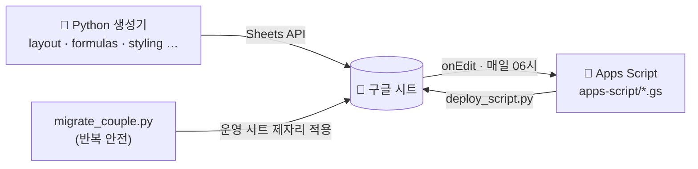

# 🛠️ 설치·개발 가이드

[← README로](../README.md) · [사용법](USAGE.md)

## 구조 한눈에



| 폴더·파일 | 역할 |
|---|---|
| `layout.py` `formulas.py` `styling.py` … | 시트 구조·수식·서식을 만드는 Python 생성기 |
| `migrate_couple.py` | **운영 시트에 변경을 제자리 적용** (여러 번 실행해도 안전) |
| `apps-script/*.gs` | 시트에 붙는 스크립트 (`logic.gs` 순수 로직, `triggers.gs` 시트 연동, `meritz.gs`·`kis.gs` 증권) |
| `tests/` | pytest(생성기) + node(스크립트, `fake_sheets.js` 가짜 시트) |
| `docs/` | 사용법·설계 문서 |

## 처음 한 번 (새 시트를 만들 때)

1. GCP에서 **Sheets · Drive · Apps Script API** 사용 설정. <https://script.google.com/home/usersettings> 에서 Apps Script API 켜기.
2. 환경 변수 설정
   ```bash
   export BUDGET_CLIENT_SECRET=<client_secret.json 경로>
   export BUDGET_PARTNER_EMAIL=<배우자 이메일>
   ```
3. 인증: `python3 auth.py` → 브라우저 허용 → `python3 auth.py "<주소창 URL>"`
4. 시트 생성: `python3 build_budget.py "우리집 가계부"` → 출력된 URL 열기 (배우자에게 편집 권한 메일 발송)
5. 스크립트 올리기: `python3 deploy_script.py`
6. 시트 **확장 프로그램 → Apps Script** → 함수 `setupTriggers` 선택 → ▶ 실행 → 권한 허용 (1회)
7. 폰: 구글 시트 앱 → 홈 화면에 추가

## 이름 설정 (신랑·신부 → 실제 이름)

코드와 문서에는 실제 이름을 쓰지 않고 **신랑 / 신부**만 씁니다. 직접 만든 시트에 실제 이름을 쓰려면 저장소 폴더에 `.names` 파일(두 줄: 신랑 이름, 신부 이름)을 만들거나 환경 변수 `BUDGET_NAMES="이름1,이름2"`를 지정하세요.

- 시트 탭 이름(`주식_이름`·`메리츠_이름`), 사용자 칸, 사용법 문구가 그 이름으로 만들어집니다.
- `deploy_script.py`가 Apps Script를 올릴 때 코드 안의 신랑·신부도 같은 이름으로 바꿉니다.
- `.names`는 `.gitignore` 대상이라 git에 올라가지 않습니다. 테스트(`conftest.py`)와 `verify_*.py`는 항상 기본 이름으로 돌아갑니다.
- 이미 만든 시트에서 사용자 이름만 바꾸려면 `설정`의 사용자 칸을 한 칸씩 고치면 됩니다(과거 내역도 따라 바뀜).

## 평소 작업 흐름

| 하고 싶은 일 | 명령 |
|---|---|
| 테스트 (생성기) | `python3 -m pytest -q` |
| 테스트 (스크립트) | `node --test tests/*.test.js` |
| 스크립트 수정 반영 | `python3 deploy_script.py` |
| 운영 시트에 변경 적용 | `python3 migrate_couple.py` |
| 임시 시트 통합 시험 | `python3 verify_couple.py` · `verify_invest.py` · `verify_meritz.py` · `verify_asset_status.py` |
| 빈 시트 전체 시험 | `python3 verify_budget.py` |

권장 순서: **브랜치 → 테스트 먼저(실패 확인) → 구현 → 전체 테스트 → `deploy_script.py` → `migrate_couple.py` → 시트에서 확인**.

## 🔒 올리면 안 되는 것

`.gitignore`가 아래를 막고 있습니다. 커밋은 `git add -A` 대신 **파일 경로를 지정**해서 하세요.

| 파일 | 이유 |
|---|---|
| `token.json` · `client_secret*.json` · `.env` · `*.key` · `*.pem` | 구글/증권 인증 정보 |
| `.spreadsheet_id` · `.script_id` | 운영 시트·스크립트 식별자 |
| `메리츠.txt` · `*snapshot*.json` | 증권 키·계좌 스냅샷 |
| `.names` | 실제 사용자 이름 (로컬 설정) |
| `.old/` · `.superpowers/` · `tools/` · `docs/private/` | 로컬 작업물 |

- 구글 토큰은 `~/.config/budget-book/token.json`(권한 600, `BUDGET_TOKEN_FILE`로 변경).
- 증권 앱 키·계좌번호는 코드·git·시트에 두지 않고 각 사용자의 UserProperties에만 둡니다. 메리츠·한투는 **조회 전용**(주문·환전 없음).

## 개발 메모

- 운영 `대시보드`는 생성 뒤 표·차트 위치가 바뀌어 코드 배치와 다릅니다. 마이그레이션은 운영 위치를 읽어 맞춥니다.
- 메뉴·드롭다운 문구는 Python(`layout.py`)과 Apps Script(`logic.gs`)에 **같이** 있고, 테스트가 서로 대조합니다.
- 배지(업데이트일)는 `계산!C5` 한 곳을 모든 탭이 읽습니다. `dailyJob`만 씁니다.
- 체크박스·월/연도 이동 같은 `onEdit` 경로는 가짜 시트로 시험하며, 실제 시트 실행은 사용하면서 확인합니다.
- 사용자 입력 칸(빠른입력 B열, 설정 I13 결과 등)은 `values()`가 덮어쓰지 않게 합니다.
